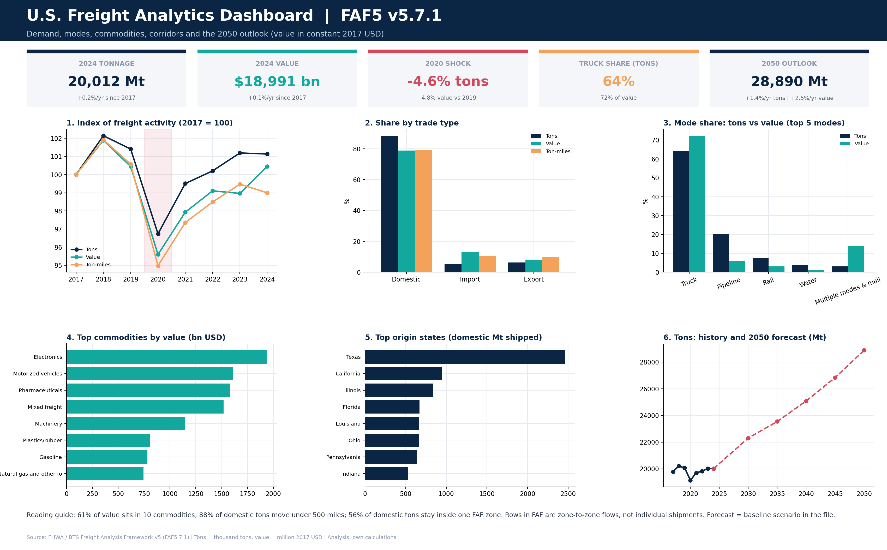

# U.S. Freight Analysis: FAF5 v5.7.1
*Data: FHWA / BTS Freight Analysis Framework version 5 (2.67 million rows, 2017-2024 history and 2030-2050 forecast). Value is in constant 2017 USD.*

---
# Executive Summary
U.S. freight in 2024 totals 20,012 million tons worth $18,991 billion (2017 USD). Activity has been essentially flat since 2017 apart from a 4.6% tonnage drop in 2020. Trucks carry 64% of tons and 72% of value, 88% of domestic tons move under 500 miles, and value is concentrated in a few commodities (61% in ten). The baseline forecast implies 44% more tons and 91% more value by 2050, with trucks absorbing most of the growth. Priorities: regional truck capacity, gateway resilience, value-based commodity segmentation and scenario planning.
Limits: FAF figures are modelled estimates; value is in constant 2017 dollars; the file holds one forecast scenario with forecast years from 2030; rows are zone-to-zone flows, not shipments; ton-miles cover the domestic leg only.

---
## 1. Business Problem
A freight strategy / logistics planning team needs to know where U.S. freight demand is concentrated, how it is changing, and how it is expected to evolve to 2050 by trade type, mode, commodity, corridor and distance, in order to decide (1) which modes, corridors and gateways need capacity first, (2) which commodity segments deserve priority (volume versus value), and (3) where the main risks are (concentration, shocks).

## 2. Data Collection
* **Source:** FAF5.7.1.csv (1.18 GB, 2,671,386 rows, 58 columns) plus FAF5_metadata.xlsx (code books for states, 132 domestic zones, 8 foreign regions, 42 commodities, 8 modes, trade types, 8 distance bands).
* **Grain:** one row = a flow between an origin and destination zone, for a commodity, mode, trade type and distance band (not an individual shipment).
* **Units:** tons = thousand tons; value = million 2017 USD; ton-miles = million (domestic portion only).
* **Used in this analysis:** history 2017-2024 (tons, value, ton-miles) and baseline forecast 2030-2050 (tons, value).

## 3. Data Cleaning and Quality Findings
| Check | Result |
|---|---|
| Rows / key duplicates | 2,671,386 / 0 duplicates on the 10 key columns |
| Missing numeric cells / negative values | 0 / 0 |
| Blank foreign fields | Structural, not errors: blank for domestic rows; origin fields filled only for imports, destination fields only for exports (verified 100% by trade type) |
| Unknown codes vs code books | None |
| Rows with zero tons in all years 2017-2024 | 474 (kept; no effect on totals) |
| Rows with tons_2024 = 0 but value_2024 > 0 | 1,106 (tonnage rounding; row-level value-per-ton is extreme, so all value-per-ton figures are computed from aggregates) |
| Leading zeros in codes (e.g. 011, 01) | Read as text, otherwise zones and commodities would be mis-labelled |

**Cleaning steps:** codes read as text then stored as category; labels added from the code books; state derived from the first two digits of the zone code; an aggregated analysis cube (5,330 rows) built and reconciled to the raw totals.

## 4. Exploratory Analysis
### 4.1 Overall trend
| Year | tons_mt | value_bn | tmiles_bn | value_per_ton_usd | avg_haul_miles |
|---|---|---|---|---|---|
| 2017 | 19,786.4 | 18,906.8 | 5,436.3 | 955.5 | 274.7 |
| 2018 | 20,210.5 | 19,264.8 | 5,540.9 | 953.2 | 274.2 |
| 2019 | 20,065.1 | 18,991.4 | 5,467.6 | 946.5 | 272.5 |
| 2020 | 19,139.9 | 18,073.8 | 5,163.0 | 944.3 | 269.8 |
| 2021 | 19,688.9 | 18,515.2 | 5,292.6 | 940.4 | 268.8 |
| 2022 | 19,827.2 | 18,737.5 | 5,354.0 | 945.0 | 270.0 |
| 2023 | 20,022.6 | 18,710.8 | 5,407.7 | 934.5 | 270.1 |
| 2024 | 20,011.5 | 18,991.2 | 5,381.7 | 949.0 | 268.9 |

*(tons in million tons, value in billion 2017 USD, ton-miles in billion; value per ton in USD; average haul in miles)*

### 4.2 Trade type (2024)
| Trade | tons_mt | tons_share_% | value_bn | value_share_% | tons_cagr_% | value_cagr_% | value_per_ton_usd |
|---|---|---|---|---|---|---|---|
| Domestic | 17,656.4 | 88.2 | 14,980.6 | 78.9 | 0.1 | -0.1 | 848.5 |
| Import | 1,096.9 | 5.5 | 2,444.9 | 12.9 | -1.2 | 1.1 | 2,228.8 |
| Export | 1,258.2 | 6.3 | 1,565.8 | 8.2 | 1.7 | 0.1 | 1,244.4 |

### 4.3 Domestic mode (2024)
| Mode | tons_mt | tons_share_% | value_share_% | tmiles_share_% | tons_cagr_% | value_per_ton_usd | avg_haul_miles |
|---|---|---|---|---|---|---|---|
| Truck | 12,843.9 | 64.2 | 72.1 | 44.7 | 0.0 | 1,066.5 | 187.5 |
| Pipeline | 4,025.3 | 20.1 | 5.8 | 20.3 | 2.2 | 275.6 | 271.6 |
| Rail | 1,532.8 | 7.7 | 3.1 | 18.0 | -0.7 | 380.9 | 633.1 |
| Water | 771.5 | 3.9 | 1.4 | 6.5 | -2.4 | 336.0 | 453.0 |
| Multiple modes & mail | 634.5 | 3.2 | 13.8 | 10.1 | -1.1 | 4,127.0 | 858.8 |
| No domestic mode | 116.4 | 0.6 | 0.2 | 0.0 | -8.0 | 348.5 | 0.0 |
| Other/unknown | 80.3 | 0.4 | 0.2 | 0.1 | -3.4 | 425.1 | 97.1 |
| Air | 6.7 | 0.0 | 3.4 | 0.1 | 0.5 | 96,539.1 | 1,163.1 |

### 4.4 Top commodities by value (2024)
| Commodity | tons_mt | value_bn | value_share_% | value_per_ton_usd | tons_cagr_% |
|---|---|---|---|---|---|
| Electronics | 107.7 | 1,936.0 | 10.2 | 17,975.5 | 3.8 |
| Motorized vehicles | 226.3 | 1,608.3 | 8.5 | 7,107.4 | 1.3 |
| Pharmaceuticals | 39.1 | 1,585.4 | 8.3 | 40,592.8 | 7.2 |
| Mixed freight | 433.8 | 1,517.6 | 8.0 | 3,498.2 | -0.3 |
| Machinery | 132.1 | 1,148.3 | 6.0 | 8,691.3 | -0.1 |
| Plastics/rubber | 281.4 | 806.5 | 4.2 | 2,865.8 | -0.0 |
| Gasoline | 1,460.0 | 782.8 | 4.1 | 536.2 | -0.2 |
| Natural gas and other fossil products | 3,081.9 | 743.6 | 3.9 | 241.3 | 1.5 |
| Other foodstuffs | 687.9 | 737.0 | 3.9 | 1,071.3 | 0.1 |
| Misc. mfg. prods. | 94.7 | 733.8 | 3.9 | 7,748.4 | -1.8 |

## 5. Analysis
### 5.1 Goods trade balance by foreign region (2024, billion 2017 USD)
| Region | imports_bn | exports_bn | balance_bn | imports_cagr_% | exports_cagr_% |
|---|---|---|---|---|---|
| Eastern Asia | 634.0 | 268.0 | -366.0 | -2.0 | -1.9 |
| Europe | 517.8 | 345.3 | -172.5 | 2.4 | 2.5 |
| SE Asia & Oceania | 283.5 | 122.4 | -161.1 | 7.2 | 1.5 |
| Mexico | 411.1 | 256.4 | -154.7 | 3.5 | 0.8 |
| Canada | 330.1 | 286.4 | -43.7 | -0.1 | -1.9 |
| SW & Central Asia | 132.8 | 98.9 | -34.0 | 0.3 | 0.5 |
| Africa | 27.2 | 23.6 | -3.6 | -2.0 | 1.9 |
| Rest of Americas | 108.3 | 164.8 | 56.5 | -0.2 | 0.6 |

### 5.2 Forecast by domestic mode (baseline, 2024 to 2050)
| Mode | tons_2024_mt | tons_2050_mt | added_tons_mt | tons_cagr_24_50_% | value_cagr_24_50_% |
|---|---|---|---|---|---|
| Truck | 12,843.9 | 19,304.3 | 6,460.3 | 1.6 | 2.5 |
| Pipeline | 4,025.3 | 5,102.5 | 1,077.2 | 0.9 | 0.5 |
| Multiple modes & mail | 634.5 | 1,188.7 | 554.3 | 2.4 | 3.3 |
| Water | 771.5 | 1,238.1 | 466.5 | 1.8 | 2.0 |
| Rail | 1,532.8 | 1,910.9 | 378.1 | 0.9 | 2.2 |
| Air | 6.7 | 13.0 | 6.3 | 2.6 | 2.9 |
| No domestic mode | 116.4 | 88.7 | -27.7 | -1.0 | -1.3 |
| Other/unknown | 80.3 | 44.3 | -36.1 | -2.3 | 3.9 |

### 5.3 Commodity segmentation (value density x forecast growth; thresholds = medians)
| Segment | commodities | value_2024_bn | added_value_bn | added_tons_mt |
|---|---|---|---|---|
| Bulk growth | 7.0 | 802.5 | 1,047.3 | 2,220.0 |
| Bulk, steady | 14.0 | 4,440.5 | 1,139.7 | 4,040.1 |
| High-value growth | 14.0 | 10,030.6 | 12,384.3 | 2,270.9 |
| Premium, steady | 7.0 | 3,717.6 | 2,720.2 | 347.9 |

## 6. Dashboard

---
# Insights Report: U.S. Freight (FAF5 v5.7.1)
1. **Scale and trend.** Freight reached 20,012 million tons and $18,991 billion (2017 USD) in 2024. Since 2017 it has been essentially flat: tons +0.16%/yr, value +0.06%/yr, ton-miles -0.14%/yr (ton-miles are -1.0% vs 2017).
2. **2020 shock.** Versus 2019, tons fell 4.6%, value 4.8% and ton-miles 5.6%. Ton-miles fell the most, so average hauls shortened. By 2024 tonnage is -0.3% vs 2019, but ton-miles are -1.6%.
3. **Trade mix.** Domestic flows are 88% of tons and 79% of value; imports 5% of tons but 13% of value; exports 6% / 8%. Imports are worth about $2,229 per ton versus $848 domestically.
4. **Modes.** Truck carries 64% of tons and 72% of value (average haul 187 miles). Pipeline carries 20% of tons but 6% of value. Air carries 0.03% of tons but 3.4% of value.
5. **Volume is not value.** Natural gas and other fossil products leads tonnage while Electronics leads value. The top 10 commodities hold 61% of value and 18 of 42 commodities make up 80%.
6. **Local and short-haul dominates.** 88% of domestic tons move under 500 miles and 56% stay inside a single FAF zone. The top 100 zone pairs carry 54% of domestic tons (89 of them are within-zone flows). Largest corridors between different zones: Rest of TX  ->  Houston TX; Rest of TX  ->  New Orleans LA-MS (LA Part); Mississippi  ->  Rest of AL.
7. **Geography.** Texas ships 14% of domestic tons (within-state flows included). The top 3 import entry regions handle 29% of import value.
8. **Foreign trade.** Goods flows show an import surplus of $879 billion in 2024 (2017 USD). Imports from SE Asia & Oceania grew 7.2%/yr since 2017, while imports from Eastern Asia changed -2.0%/yr.
9. **Outlook to 2050 (baseline).** Tons rise 44% to 28,890 Mt (+1.42%/yr) and value 91% to $36,283 bn (+2.52%/yr), so the mix shifts toward higher-value goods. Truck absorbs 73% of added tons; Multiple modes & mail grows fastest among larger modes; biggest tonnage additions: Natural gas and other fossil products, Gravel, Basic chemicals.
10. **Portfolio.** 14 'high-value growth' commodities hold 53% of 2024 value and deliver 72% of the value added by 2050.

---
# Business Recommendations
1. **Prioritise regional and metro truck capacity.** Trucks carry 64% of tons, 88% of domestic tons move under 500 miles and 56% stay within one zone. Focus first on intra-regional distribution, drayage and terminal access.
2. **Plan around the gateways.** The top 3 import entry regions handle 29% of import value; run gateway-level capacity and resilience reviews there.
3. **Segment by value density, not tonnage alone.** Protect reliability and speed for the 18 commodities that make up 80% of value (e.g. Electronics, Motorized vehicles, Pharmaceuticals); manage bulk commodities such as Natural gas and other fossil products on cost and volume.
4. **Build shock resilience.** The 2020 drop (4.6% in tons, 5.6% in ton-miles) shows exposure; keep flexible capacity and alternative modes.
5. **Watch sourcing shifts.** Imports from SE Asia & Oceania grew 7.2%/yr; check whether gateway and corridor plans match the changing origins.
6. **Use the 2050 outlook as a scenario.** Trucks absorb 73% of the extra tons; test infrastructure and fleet plans against this and refresh when FAF updates.
7. **Close data gaps before committing capital.** Add costs, congestion, shipment-level data and monthly volumes.

---
## 7. Presentation outline (10 slides)
1. **Title and question:** "Where is U.S. freight, and where is it going?"
2. **Executive summary:** 4 headline numbers (20.0 bn tons, $19.0 tn, truck share, 2050 outlook).
3. **Data and method:** FAF5, grain, units, cleaning checks.
4. **Trend and the 2020 shock:** index chart (2017 = 100).
5. **Trade type and modes:** shares of tons versus value (truck, pipeline, air).
6. **Commodities:** volume versus value; top 10 hold 61% of value.
7. **Geography and corridors:** states, import gateways, local versus long-haul.
8. **Outlook to 2050:** tons +44%, value +91%, truck absorbs 73% of added tons.
9. **Portfolio segments:** high-value growth commodities.
10. **Recommendations, risks and next steps.**

## 8. Limitations
* FAF figures are modelled estimates, not a census of shipments; treat small differences with caution.
* Value is in constant 2017 dollars, so growth excludes inflation (current-dollar columns exist but were not used).
* The file contains one forecast scenario and forecast years from 2030 only; 2025-2029 are not in the file.
* Ton-miles cover the domestic leg only; domestic mode for imports/exports is the domestic leg.
* Same-zone flows dominate; "top lanes" must be read with that in mind.
* No cost, congestion, capacity or monthly data, so capacity needs are inferred, not measured.
